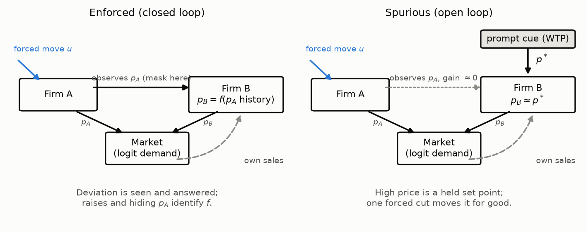
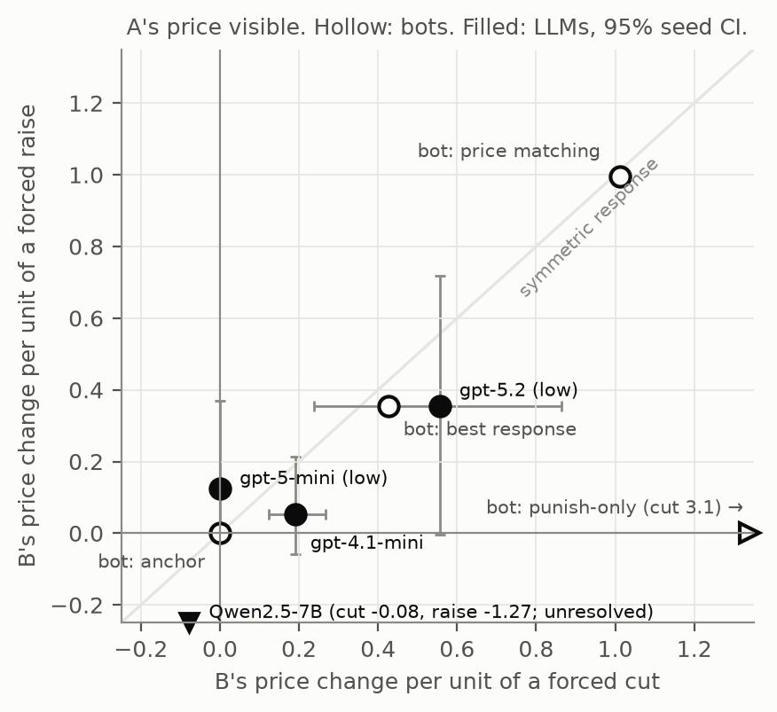
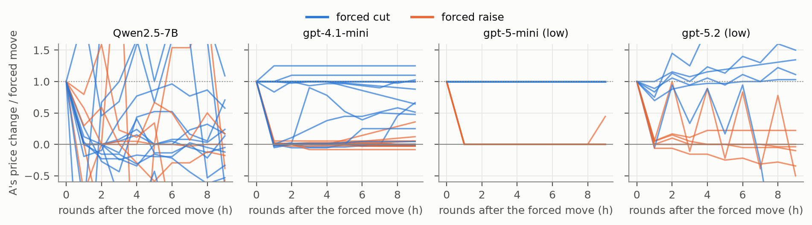
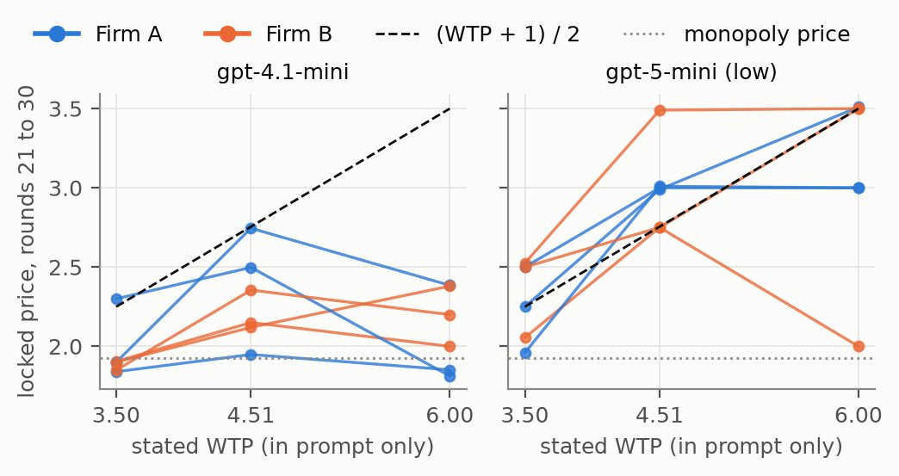
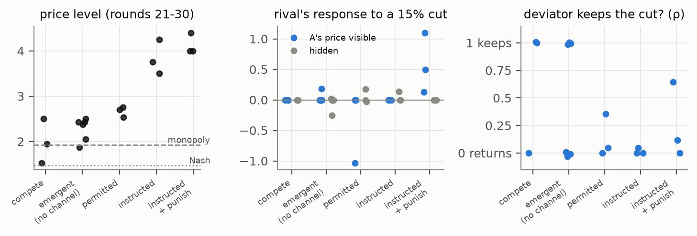
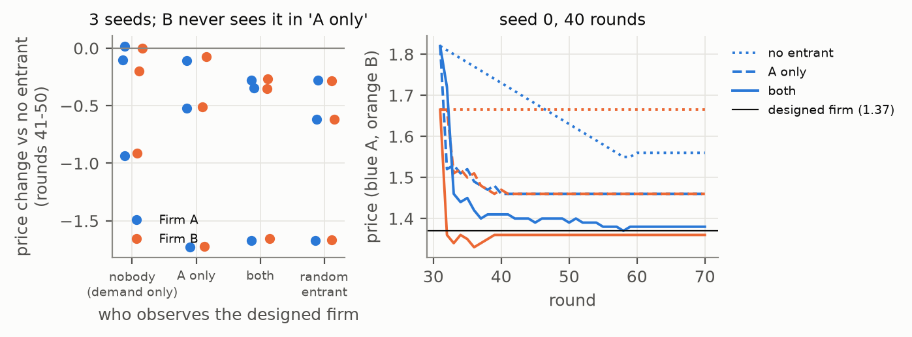

# Is It a Cartel? Separating Enforced from Spurious Collusion in LLM Pricing Agents

**Question.** When LLM pricing agents keep prices above the competitive level, are they *enforcing* a cartel (deviations are answered) or merely *anchored* (high prices persist because nobody explores)? Only the first is collusion in the economic sense (Harrington 2018; Calvano et al. 2020), and the two call for different remedies.

**Approach.** A black-box **causal audit**:
1. Save the state of a repeated pricing game (Calvano logit duopoly, Fish et al. agents).
2. Re-run it from that state with one change: a forced price **cut or raise**, the rival's price **hidden**, a **stranger** as partner, or a third firm. Then measure how each agent responds and whether the deviation **pays**.
3. Fix every metric and classification rule before any LLM data ([`METHODS.md`](METHODS.md), with a change log), and validate the audit on scripted bots with known mechanisms first.

Built during the [Apart Research AI Collusion Sprint](https://apartresearch.com/sprints/ai-collusion-research-sprint-2026-10-23-to-2026-10-25) (23 to 25 Oct 2026). Tracks: 2.3 *What should count as convincing evidence of collusion?* (primary), 1.3, 1.2 and 3.2.

---

## Main results

13,950 model calls, $46.02. Every call and its cost is in [`logs/usage.jsonl`](logs/usage.jsonl). Full numbers, with seeds and confidence intervals, are in [`RESULTS.md`](RESULTS.md).

| # | Finding | Evidence | Status |
|---|---|---|---|
| 1 | **The audit recovers the response type of known mechanisms.** A cuts-only test (the current standard) cannot tell price matching from punishment; adding a forced *raise* separates them. | 5 scripted bots (anchor, best response, best response that infers a hidden price, matching, punish-only): response type recovered for all 5; the deviator's return rate is recovered (ρ = 0.50, true value 0.5); the final verdict rule mislabels the 2 best-responder bots (RESULTS §16) | types recovered; verdict rule has a known flaw |
| 2 | **In two of the three models we could read, emergent high prices are spurious.** Prices sit *above the monopoly price*, rivals rarely respond, and cuts pay. | gpt-5-mini (3 seeds) and gpt-4.1-mini (6 seeds): 17/18 firm-runs above monopoly; both meet the pre-registered "spurious" rule | robust |
| 3 | **After one forced cut the price stays low for the rest of the 10-round branch** (gpt-5-mini). | Cut kept in 18/18 branches, raise reverted in 18/18; the cut pays +142 to +149 | robust within the horizon |
| 4 | **A prompt number that does not enter demand sets the anchor.** | Changing the stated willingness to pay from round 1 moves gpt-5-mini's locked price: slope 0.30, 95% CI [0.13, 0.42] | robust (3 seeds) |
| 5 | **The one responsive model responds to its rival but does not deter cuts.** | gpt-5.2 (low effort, 6 seeds): pass-through 0.56 for cuts and 0.36 for raises (best response 0.23 / 0.18; above it in 4/6 seeds, Wilcoxon p = 0.078, not significant); larger when it can see the rival's price (Wilcoxon p = 0.031); cut deterrence inconclusive | medium |
| 6 | **Elicited collusion is a positive control.** Told to punish, gpt-4.1-mini punishes visible cuts, and the audit detects it. No run met the pre-registered *enforced* rule: cuts still pay slightly. | gpt-4.1-mini with a message channel: punishes visible 15% cuts only, 3/3 seeds; cartels persist after the instruction is withdrawn, 3/3; Qwen did not follow the punishment instruction | 3 seeds (sign test p = 0.125) |
| 7 | **In Qwen2.5-7B, an activation probe trained on instructed collusion learns the instruction.** | Held-out AUROC 1.0, yet cartels whose instruction was withdrawn score 0.16 to 0.36; one run per condition | exploratory |
| 8 | **A designed third firm's effect spreads through the network.** It lowers the price of an incumbent that never observes it, but it does **not** beat a random entrant. | gpt-5.2: B falls in 3/3 seeds when only A sees the stubborn firm (sign test p = 0.125) | observation; failures reported |

**Robustness** (post hoc, [`RESULTS.md` §16](RESULTS.md)):
- **Sensitivity:** no verdict changes across 9 combinations of response window and detection threshold.
- **Exact tests:** with 3 seeds, seed-level patterns cannot go below p = 0.125, so we call them "consistent", not significant.
- **Two flaws in our own pre-registered rules:** a best-responder bot is labelled "enforced", and an explicit cartel without punishment is labelled "spurious". Both are reported, not fixed.

The same supra-monopoly signature appears in the starter repo's own 216 Mistral-Large runs: under prompt P1, 37/105 runs have a firm above monopoly ([`results/reanalysis/`](results/reanalysis)).

<p align="center">
<br>
<em>Enforced (closed-loop) vs spurious (open-loop) high prices, and where the audit intervenes.</em>
</p>

<p align="center">
 <br>
<em>Left: rival's response to forced cuts vs raises; hollow markers are bots with known mechanisms. Right: the deviator keeps forced cuts and reverts raises.</em>
</p>

<p align="center">
<br>
<em>The willingness-to-pay number in the prompt (which demand never uses) moves where gpt-5-mini's price settles.</em>
</p>

<p align="center">
<br>
<em>Elicited collusion: price level, the rival's response to a forced 15% cut, and whether the deviator keeps its cut, by condition.</em>
</p>

<p align="center">
<br>
<em>A designed stubborn third firm: price changes by who can see it (3 seeds), and 40-round paths.</em>
</p>

Figure captions with their claims and caveats: [`figures/CAPTIONS.md`](figures/CAPTIONS.md). A runnable walkthrough that needs no API key: [`notebooks/demo.ipynb`](notebooks/demo.ipynb).

### What did not work (reported in full in `RESULTS.md`)

| Area | Result |
|---|---|
| Qwen2.5-7B at T = 1 | Too noisy for the forced-deviation design; reported as unresolved, not as anchored. |
| Designed third firm | The "visibility only" effect, the theory's ordering of pinning one vs both firms, and "designed beats random" all failed to replicate. |
| Prompt-matched activation probe | Separates histories when the prompt is fixed, but does not transfer across prompt formats. |
| Agreement marker ("abandons profitable, unpunished cuts") | Fires on 8/8 agreement branches but also on 4/12 emergent gpt-4.1-mini branches, so it is an observation, not a detector. |

---

## What is new and what is pre-existing

| Path | Status |
|---|---|
| [`starter/`](https://github.com/poseidon-research/collusion_hackathon) (git submodule, pinned to `d585a7b`) | **Pre-existing**, unmodified: the sprint starter repo. We use its `algorithmic-pricing-llms` project (market, prompts, agents, experiment runner; by Peist, Romero & Sauer) and its shipped 216-run dataset. |
| `probe/`, `bin/`, `notebooks/`, `results/`, `figures/`, `METHODS.md`, `RESULTS.md`, `CITATIONS.md` | **New**, written during the sprint |

The audit subclasses the starter's classes and never edits starter files.

## Code map (`probe/`)

| Module | Role |
|---|---|
| `branching.py` | `ProbeExperiment`: restart a saved game and apply one intervention (forced price, hiding, notes wipe, per-edge visibility, advisor note, message channel) |
| `design.py` | The pre-registered experimental design: which warm-ups and branches exist per model and seed |
| `run_branch.py` | Run one warm-up or branch from a JSON spec (one process per run) |
| `run_screen.py` | Run a sweep: prints calls and estimated cost, **refuses to start without `--approved-usd`**, logs actual cost |
| `providers.py` | OpenAI-compatible client that logs tokens and cost for every call and enforces hard spend caps |
| `config.py` | Models, prices, spend caps |
| `economics.py` | Benchmarks for the starter's demand: best response, Nash and monopoly prices, demand inversion |
| `bots.py` | Scripted agents with known mechanisms; they read the same prompt an LLM gets |
| `learners.py` | Algorithmic third firms: multiplicative weights, random, stubborn |
| `elicit.py` | Line D: the message channel and the elicitation conditions |
| `analysis.py` | Pre-registered metrics: β, β_BR, ρ, ΔΠ_A, detection, cue slopes, advice gain |
| `activations.py` | Line D2: rebuild prompts, extract local Qwen activations, train probes |
| `figures.py` | All figures |
| `tests/` | 14 tests: masking, forced-price accounting, bot validation, entrant learning, advice injection |

## Setup

Requirements: [uv](https://github.com/astral-sh/uv) and Python 3.11 or later. Tested on macOS (Apple Silicon).

```bash
git clone --recurse-submodules <this repo>
cd <repo>
(cd starter/algorithmic-pricing-llms && uv sync)        # starter environment (pre-existing)
cp starter/compute.env.example starter/compute.env      # then add keys (never committed)
#   OPENAI_API_KEY=...       for gpt-4.1-mini, gpt-5-mini, gpt-5.2
#   OPENROUTER_API_KEY=...   for qwen/qwen-2.5-7b-instruct
```

`bin/probe <module> ...` runs `python -m probe.<module>` inside the starter environment.

**Behind a TLS-inspecting proxy** (for example Zscaler): put a combined CA bundle (system roots plus the proxy root) at `.certs/ca-bundle.pem`. `probe` uses it automatically.

## Reproduce

```bash
# 1. Free: scripted-bot validation and tests (no API calls)
for b in anchor br br_infer match punish; do bin/probe run_screen --model bot_$b --seeds 0; done
uv run --project starter/algorithmic-pricing-llms --with pytest pytest probe/tests -q

# 2. Free: recompute every table and figure from the saved runs
bin/probe analysis
bin/probe figures

# 3. Paid: re-run a sweep (prints calls and cost; needs an approved budget)
bin/probe run_screen --model gpt41mini --seeds 0 1 2 --design full --approved-usd 3.00
#   --design lite (gpt-5.2), cue, advice, elicit, designed [--long]; --smoke for a 3-round test

# 4. Activation probes (local, needs ~15 GB for Qwen2.5-7B-Instruct in models/)
uv run --project starter/algorithmic-pricing-llms --with torch --with transformers \
    --with accelerate --with scikit-learn python -m probe.activations extract
#   ...then `probe` and `probe_matched` the same way
```

### Spending safeguards

| Safeguard | Behaviour |
|---|---|
| Approval gate | A sweep starts only if its estimate is at or below `--approved-usd`. The gate checks the *estimate*; two sweeps overshot their approvals by $0.01 to $0.07, both logged. |
| Hard caps | Per-provider caps in `probe/config.py`, checked against the usage ledger before every call. |
| Fatal errors | Out-of-credit errors are fatal, so no retry storms. Retries are capped at 4 per decision. |

## Design and pre-registration

[`METHODS.md`](METHODS.md) contains:
- the environment;
- the branch design;
- metric definitions;
- classification rules with their thresholds;
- the bot validation;
- the follow-up designs (sections 11 to 14);
- a dated change log, including the corrections made after seeing data.

Exploratory results are labelled as such in `RESULTS.md`.

## Limitations

| Limitation | Consequence |
|---|---|
| One market, one prompt family (Fish P1) | Findings may not transfer to other prompts or markets |
| Short horizons (30-round warm-up, then 10 to 40 rounds) | Longer games could change the deterrence results |
| 3 to 6 seeds | Coarse confidence intervals |
| Low reasoning effort for the gpt-5 models | Behaviour at default or high effort may differ |
| gpt-5.2 tested at ±10% only | Larger deviations untested |
| Hiding the rival's price is imperfect monitoring, not blinding | The rival still sees its own sales |
| Classifications describe behaviour, not intent | No claim about what the models "mean" |
| Activation results come from one run per condition | Exploratory only |

The dual-use discussion is in the report appendix: the levers we find (exploration suppression, prompt anchors, non-responsive agents) could be inverted.

## Citation

If you use this code, please cite the sprint report (link to follow) and the starter project:
- Fish, Gonczarowski & Shorrer (2024), *Algorithmic Collusion by Large Language Models*, arXiv 2404.00806.
- Calvano, Calzolari, Denicolò & Pastorello (2020), *AER* 110(10).

Every reference used is checked in [`CITATIONS.md`](CITATIONS.md).

## Authors and AI assistance

**Omanshu Thapliyal.** Code, analysis and documentation were developed with Claude (Anthropic) as a coding assistant under the author's direction. All results come from logged runs, and the author is responsible for all content.

## License

[MIT](LICENSE) for the new code (`probe/`, `bin/`, `notebooks/`). The `starter/` submodule keeps its own license (MIT).
